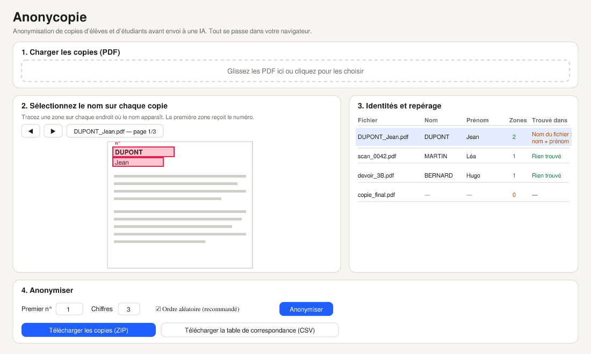
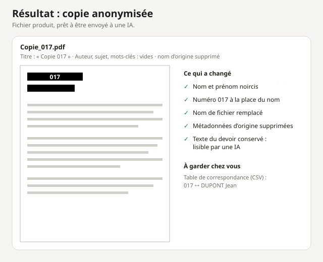

# AnonyCopies

**Anonymisez des copies d'élèves ou d'étudiants (PDF) avant de les confier à une IA.**

AnonyCopies est une page web unique (`index.html`) qui fonctionne **entièrement dans votre navigateur** : les copies ne sont envoyées nulle part, aucun serveur, aucun compte, aucune installation.

*Avant : sélection du nom sur la copie d'origine.*

*Après : copie anonymisée produite (nom noirci, numéro, métadonnées supprimées).*

## Ce que fait l'outil

- Vous sélectionnez **à la main, copie par copie**, la zone où figure le nom (une ou plusieurs zones, sur une ou plusieurs pages ; gabarits différents acceptés).
- La zone est **noircie pour de bon** et remplacée par un **numéro** (ex. `017`).
- Le texte d'origine du PDF est conservé **sauf sous les zones** : le fichier reste **lisible par une IA** (couche de texte extractible).
- Le **nom du fichier** est remplacé (`Copie_017.pdf`) et les **métadonnées** d'origine sont supprimées.
- L'outil **repère si le nom, le prénom ou les deux** figurent dans le nom du fichier ou les métadonnées (titre, auteur, sujet, mots-clés, créateur).
- Si le nom et le prénom sont sur deux lignes : 1re sélection → nom, 2e → prénom (préremplissage automatique si le PDF contient du texte).
- Numéros attribués dans un **ordre aléatoire** (option) pour éviter de retrouver les élèves par l'ordre alphabétique.
- Deux fichiers produits : un **ZIP** de copies anonymes et un **CSV de correspondance** (numéro ↔ nom), à conserver séparément pour ré-identifier les copies après correction.

## Utilisation

1. Téléchargez `index.html` (ou ouvrez la version GitHub Pages si vous l'activez) et ouvrez-le dans un navigateur récent (Chrome, Edge, Firefox, Safari).
2. Chargez les PDF.
3. Cliquez une copie dans le tableau, tracez la zone du nom sur l'aperçu. Pour un gabarit commun, le bouton « Copier ces zones vers les copies sans zone » évite de retracer la même zone.
4. Renseignez nom/prénom si besoin (facultatif).
5. Cliquez sur **Anonymiser**, puis téléchargez le ZIP et le CSV.

Une copie sans zone n'est pas bloquée : le numéro est placé en haut à gauche de la page 1, mais **rien ne masque le nom** s'il est écrit sur la copie.

## Confidentialité

- Le traitement est local ; les copies ne quittent pas votre ordinateur.
- La page charge toutefois ses trois bibliothèques (pdf.js, pdf-lib, JSZip) depuis le CDN cdnjs au chargement. Pour un usage 100 % hors ligne, téléchargez ces fichiers dans un dossier `lib/` et modifiez les trois balises `<script>` de `index.html`.

## Limites à connaître

- **Pseudonymisation, pas anonymisation au sens strict** (RGPD) : la table de correspondance permet de ré-identifier. Protégez-la.
- Une écriture manuscrite reconnaissable, un prénom cité dans le corps du devoir, un numéro d'étudiant ou une photo peuvent identifier l'élève : vérifiez vos copies et tracez des zones supplémentaires si besoin.
- Les pages sont redessinées en images (qualité JPEG élevée) : fichiers plus lourds qu'à l'origine.
- **Copies scannées/manuscrites** : pas de couche de texte, donc pas de texte extractible (reconnaissance de caractères non incluse) ; les IA capables de lire des images peuvent néanmoins les lire.
- Le texte invisible est limité aux caractères latins courants (accents français inclus) ; les autres caractères sont omis de la couche de texte.
- Les pages pivotées et les textes en biais peuvent avoir une couche de texte approximative.
- Utilisez l'outil sur quelques copies d'essai et vérifiez le résultat avant un traitement en masse.

## Technique

HTML/CSS/JavaScript en un seul fichier. Bibliothèques : [pdf.js](https://mozilla.github.io/pdf.js/) (lecture), [pdf-lib](https://pdf-lib.js.org/) (écriture), [JSZip](https://stuk.github.io/jszip/) (archive). Licence MIT.

# 
